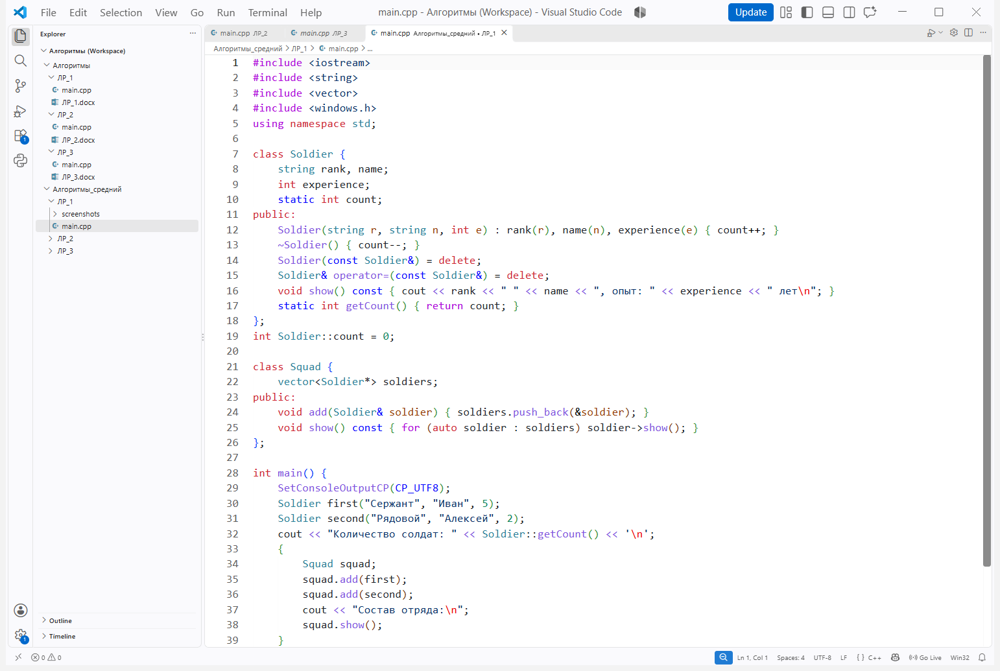
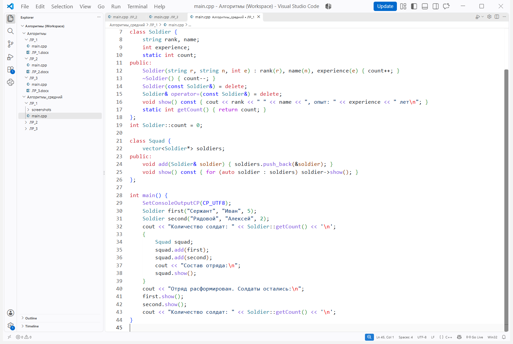
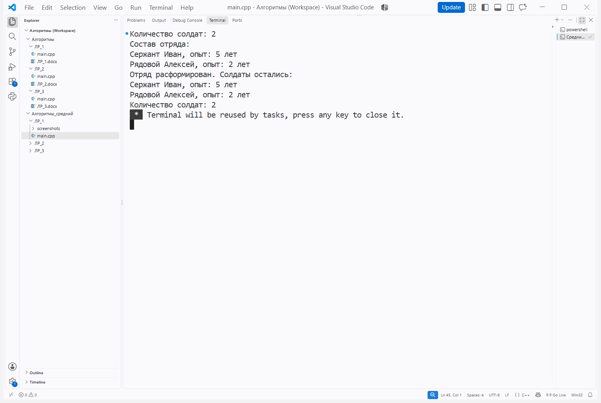

# Лабораторная работа № 1

**Тема:** Композиция и агрегация классов. Статические члены

**Цель:** Научиться реализовывать агрегацию классов и использовать статические поля для подсчёта объектов.

**Ссылка на репозиторий:** https://github.com/MAX-150-web/Algorithms

## Порядок выполнения работы

1. Ознакомился с теоретическим обоснованием работы.

2. Выполнил задачу среднего уровня.

**Вариант:** 10

**Задание:** Реализовать классы Squad (отряд) и Soldier (солдат) с отношением агрегации. Для солдата задать звание, имя и опыт; добавить статический счётчик солдат. Показать, что солдаты продолжают существовать после уничтожения отряда.

Рисунок 1 — Исходный код в Visual Studio Code, часть 1

Рисунок 2 — Исходный код в Visual Studio Code, часть 2

## Результат выполнения программы

Рисунок 3 — Сборка и выполнение программы в Visual Studio Code

После расформирования отряда данные обоих солдат доступны, счётчик показывает два объекта.

**Вывод:** Реализовал агрегацию отряда и солдат, использовал статический счётчик и проверил независимое время жизни объектов.

## Контрольные вопросы

**1. Что такое композиция? Приведите пример.**

Композиция связывает целое с принадлежащими ему частями: например, дом владеет своими комнатами. При уничтожении целого принадлежащие ему части также уничтожаются.

**2. Что такое агрегация? Чем она отличается от композиции?**

При агрегации часть создаётся и существует независимо от целого. Squad хранит указатели на Soldier и не удаляет солдат, а при композиции целое владеет частями.

**3. Как реализовать композицию в C++? Приведите пример кода.**

Часть можно хранить как поле объекта или элемент контейнера: class House { vector&lt;Room&gt; rooms; };. Контейнер автоматически уничтожает принадлежащие ему комнаты.

**4. Как реализовать агрегацию в C++? Приведите пример кода.**

Целое хранит невладеющие указатели или ссылки на внешние объекты. В программе squad.add(first) сохраняет указатель на солдата, созданного вне отряда.

**5. В чём разница между временем жизни частей при композиции и агрегации?**

Часть при композиции уничтожается вместе с владельцем, если не удалена раньше. При агрегации часть имеет отдельное время жизни: солдаты существуют после уничтожения отряда.

**6. Что такое статическое поле класса? Чем оно отличается от обычного поля?**

Статическое поле существует в одном экземпляре для класса. Обычные поля принадлежат отдельным объектам: у каждого Soldier своё имя, а count общий для всех солдат.

**7. Как объявить и определить статическое поле? Где оно хранится?**

В классе объявляют static int count;, а вне класса определяют int Soldier::count = 0;. Поле имеет статическую длительность хранения и является общим для класса.

**8. Что такое статический метод? Можно ли из него обратиться к нестатическим полям?**

Статический метод вызывается через имя класса: Soldier::getCount(). У него нет this, поэтому к нестатическим полям он обращается только через конкретный объект.

**9. Для чего используются статические счётчики объектов?**

Статический счётчик позволяет узнать число существующих объектов. В программе конструктор Soldier увеличивает count, деструктор уменьшает, а копирование запрещено.

**10. Что такое паттерн «Одиночка» (Singleton)? Для чего он нужен?**

«Одиночка» предоставляет единственный экземпляр класса и общую точку доступа к нему. Обычно используют закрытый конструктор, запрет копирования и статический метод доступа к объекту.

**11. Как запретить создание копий объекта?**

В классе можно удалить конструктор копирования и присваивание: Soldier(const Soldier&) = delete; и Soldier& operator=(const Soldier&) = delete;. Попытка копирования вызовет ошибку компиляции.

**12. В каком порядке вызываются конструкторы и деструкторы при композиции?**

Сначала поля создаются в порядке объявления, а затем выполняется тело конструктора целого. При уничтожении сначала выполняется тело деструктора, затем поля уничтожаются в обратном порядке.

**13. Можно ли изменить статическое поле из обычного метода?**

Да, обычный метод может изменять доступное ему статическое поле. Например, конструктор Soldier увеличивает count, а деструктор уменьшает его.

**14. Почему статические поля нужно определять вне класса?**

Обычное объявление статического поля внутри класса не является его определением. Определение вне класса предоставляет хранение; с C++17 inline static можно определить прямо в классе.

**15. В каких случаях стоит использовать композицию, а в каких агрегацию?**

Композицию выбирают, когда целое владеет частями. Агрегацию применяют для независимых объектов, как солдаты в отряде; объекты должны существовать, пока сохранённые указатели используются.
