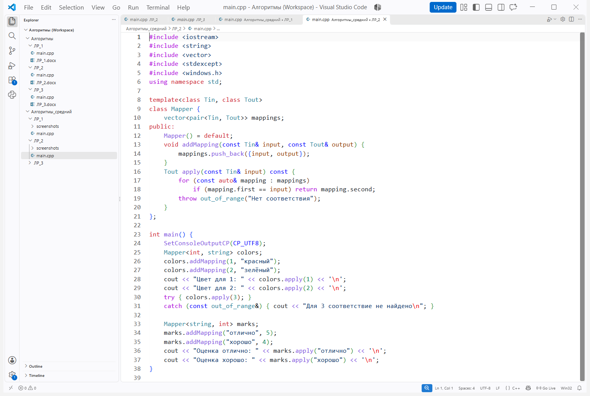
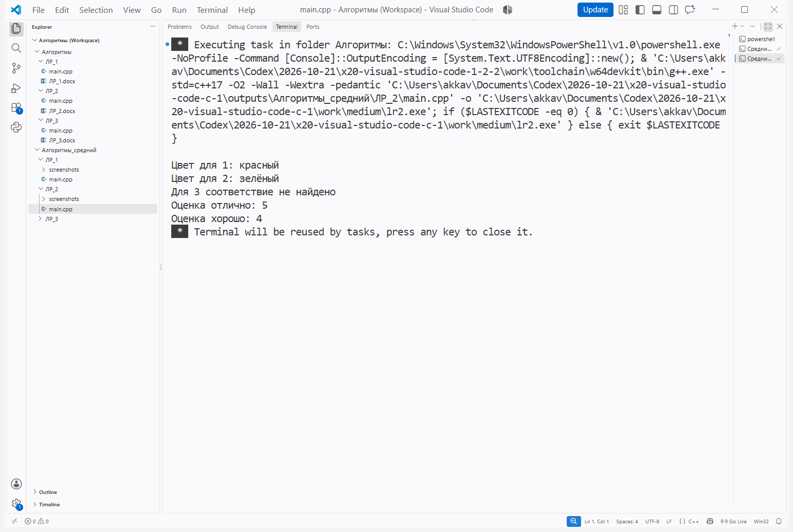

# Лабораторная работа № 2

**Тема:** Анализ сложности алгоритмов. Шаблоны классов

**Цель:** Научиться создавать и использовать шаблонные классы с несколькими параметрами типов.

**Ссылка на репозиторий:** https://github.com/MAX-150-web/Algorithms

## Порядок выполнения работы

1. Ознакомился с теоретическим обоснованием работы.

2. Выполнил задачу среднего уровня.

**Вариант:** 10

**Задание:** Реализовать шаблонный класс Mapper&lt;Tin, Tout&gt; с конструктором и методами apply и addMapping. Продемонстрировать преобразование значений для разных типов.

Рисунок 1 — Исходный код в Visual Studio Code

## Результат выполнения программы

Рисунок 2 — Сборка и выполнение программы в Visual Studio Code

Проверены преобразования чисел в цвета и названий оценок в числа; отсутствие соответствия обработано.

**Вывод:** Создал шаблонный класс Mapper, добавил соответствия и проверил его работу с разными типами данных.

## Контрольные вопросы

**1. Что такое О-нотация (Big O) и зачем она нужна?**

О-нотация задаёт асимптотическую верхнюю границу роста затрат при увеличении размера данных. Она помогает сравнивать алгоритмы независимо от конкретного компьютера, отбрасывая постоянные множители и младшие слагаемые.

**2. Какая сложность у доступа к элементу массива по индексу? Почему?**

O(1): адрес вычисляется по формуле «начало массива + индекс × размер элемента». Число действий не зависит от количества элементов.

**3. Какая сложность у бинарного поиска? Почему?**

O(log n), поскольку на каждом шаге область поиска уменьшается примерно вдвое. В массиве из n элементов требуется не более порядка log2(n) сравнений.

**4. Что означает сложность O(n log n)? Приведите пример алгоритма.**

Затраты растут пропорционально произведению числа элементов и его логарифма. Пример — сортировка слиянием: на каждом из log n уровней обрабатываются все n элементов.

**5. Что такое амортизированный анализ? Приведите пример.**

Амортизированный анализ оценивает последовательность операций, распределяя редкие дорогие действия между многими дешёвыми. Например, добавление в конец vector амортизированно O(1), хотя отдельное расширение требует O(n).

**6. Какая сложность у двух вложенных циклов по n итераций каждый?**

O(n²), если тело внутреннего цикла выполняет O(1) работы. Внешний цикл запускает внутренний n раз, то есть суммарно выполняется n × n итераций.

**7. Какая сложность у рекурсивного вычисления чисел Фибоначчи?**

У наивной рекурсии без запоминания результатов время экспоненциальное: Θ(φ^n), где φ ≈ 1,618; часто используют верхнюю оценку O(2^n). Глубина стека O(n), а с мемоизацией время становится O(n).

**8. Что такое шаблоны функций? Как их объявить и использовать?**

Шаблон описывает одну функцию для нескольких типов. Пример: template&lt;class T&gt; T twice(T x) { return x + x; }; вызовы twice(3) и twice(2.5) создают подходящие версии функции.

**9. Что такое шаблоны классов? Как их объявить и использовать?**

Шаблон класса задаёт общую реализацию с параметрами типа. Например, Mapper&lt;int, string&gt; и Mapper&lt;string, int&gt; используют один шаблон для разных входных и выходных типов.

**10. В чём преимущество шаблонов перед перегрузкой функций?**

Шаблон позволяет один раз описать одинаковый алгоритм для многих типов и проверяет типы при компиляции. Перегрузки удобнее, когда поведение для разных типов существенно различается.

**11. Как указать, что шаблонный параметр — тип?**

Используют typename или class: template&lt;typename T&gt; либо template&lt;class T&gt;. В таком объявлении оба варианта обозначают параметр типа.

**12. Можно ли создать шаблон с несколькими параметрами типов?**

Да: template&lt;class K, class V&gt; class Pair { K key; V value; };. Например, Pair&lt;int, string&gt; связывает целочисленный ключ со строковым значением.

**13. Как провести экспериментальное измерение времени выполнения?**

Фиксируют время до и после серии операций, например с помощью chrono::steady_clock. Для сравнения используют одинаковые данные и настройки сборки.

**14. Почему при измерении времени нужно выполнять операцию многократно?**

Серия операций и несколько повторений уменьшают влияние точности таймера и случайной фоновой нагрузки.

**15. Что важнее: сложность алгоритма или константа?**

На больших данных обычно решающим становится порядок роста. На небольших наборах константы, кэш и выделение памяти могут влиять сильнее, поэтому асимптотическую оценку дополняют измерениями.
