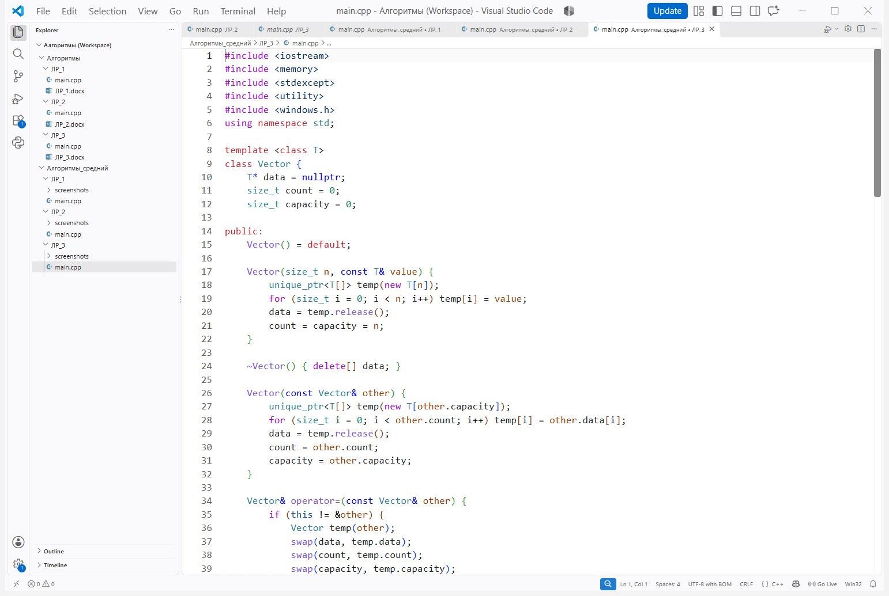
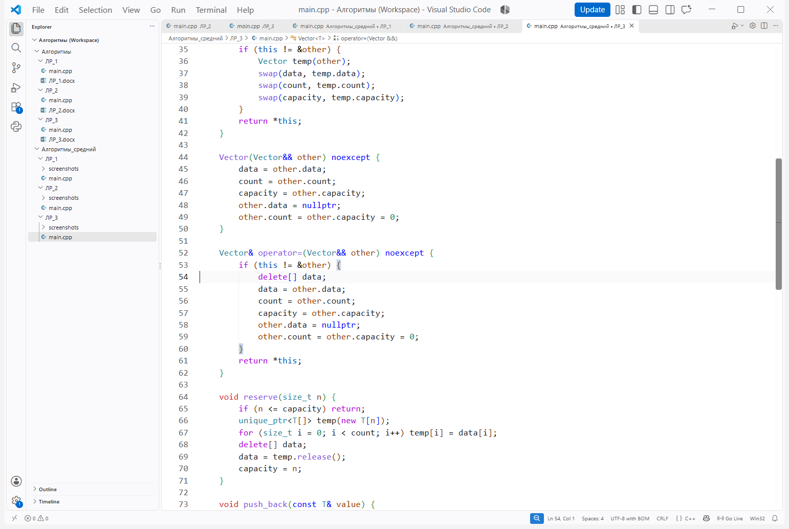
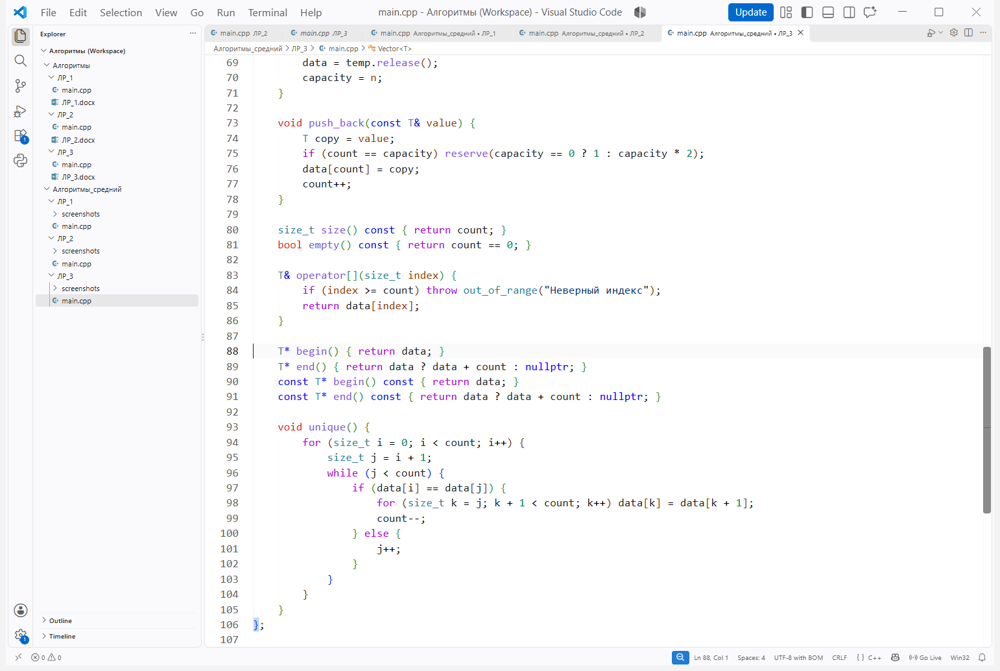
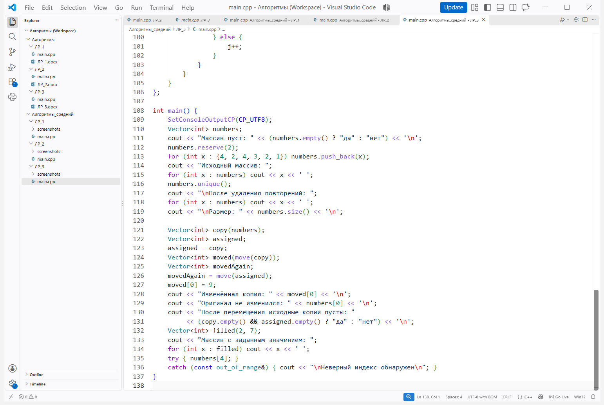
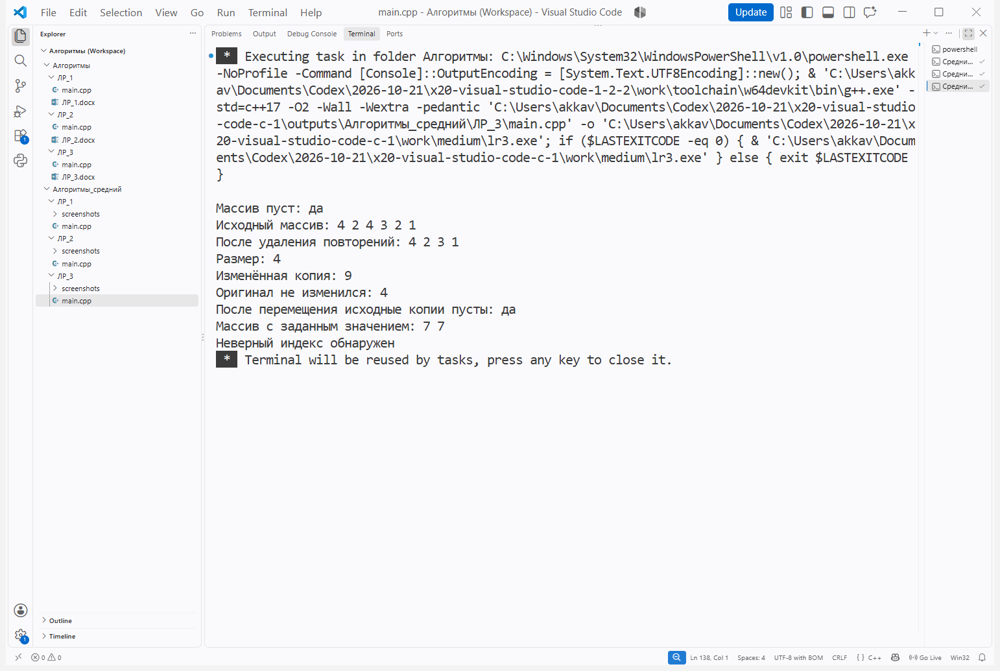

# Лабораторная работа № 3

**Тема:** Реализация динамического массива (аналог vector). Итераторы

**Цель:** Научиться создавать шаблонный динамический массив, управлять памятью и применять правило пяти.

**Ссылка на репозиторий:** https://github.com/MAX-150-web/Algorithms

## Порядок выполнения работы

1. Ознакомился с теоретическим обоснованием работы.

2. Выполнил задачу среднего уровня.

**Вариант:** 10

**Задание:** Реализовать шаблонный класс Vector с поддержкой правила пяти. Добавить метод unique для удаления повторяющихся элементов.

Рисунок 1 — Исходный код в Visual Studio Code, часть 1

Рисунок 2 — Исходный код в Visual Studio Code, часть 2

Рисунок 3 — Исходный код в Visual Studio Code, часть 3

Рисунок 4 — Исходный код в Visual Studio Code, часть 4

## Результат выполнения программы

Рисунок 5 — Сборка и выполнение программы в Visual Studio Code

Повторяющиеся значения удалены с сохранением первого вхождения. Проверены копирование, перемещение и неверный индекс.

**Вывод:** Создал динамический массив, реализовал правило пяти и метод unique для удаления повторений.

## Контрольные вопросы

**1. Почему динамический массив называется «динамическим»?**

Он может изменять количество элементов во время работы программы. При недостатке места выделяется новый участок памяти, элементы переносятся, а прежний участок освобождается.

**2. Что такое ёмкость (capacity) и чем она отличается от размера (size)?**

Размер — число записанных элементов. Ёмкость — количество элементов, для которых уже выделено место; она может быть больше размера, поэтому добавление не всегда требует нового выделения памяти.

**3. Почему при расширении массива ёмкость удваивается, а не увеличивается на фиксированное число?**

Удвоение делает расширения всё более редкими. Если прибавлять одно и то же число ячеек, при большом количестве добавлений элементы пришлось бы многократно копировать, что увеличило бы общие затраты.

**4. Какова амортизированная сложность операции push_back? Почему?**

O(1) при последовательности добавлений и удвоении ёмкости. Большинство вставок выполняются без переноса, а редкие затраты O(n) на расширение распределяются между многими вставками.

**5. Что такое «правило трёх»? Когда оно применяется?**

Если класс самостоятельно владеет ресурсом и ему нужен один из трёх методов, обычно нужны все три: деструктор, конструктор копирования и оператор присваивания копированием. Они обеспечивают корректное освобождение и независимое копирование ресурса.

**6. Что такое «правило пяти»? Чем оно отличается от «правила трёх»?**

К трём методам добавляются конструктор перемещения и оператор присваивания перемещением. Они позволяют передать владение ресурсом другому объекту без копирования всех элементов.

**7. В чём разница между конструктором копирования и оператором присваивания?**

Конструктор копирования создаёт новый объект на основе существующего. Оператор присваивания копированием заменяет содержимое уже созданного объекта и должен корректно обработать его прежний ресурс.

**8. Зачем нужна проверка if (this != &other) в операторе присваивания?**

Проверка обнаруживает присваивание объекта самому себе. В простых реализациях она защищает от удаления исходных данных; здесь копирование через временный объект безопасно и без неё, но проверка избегает лишней работы.

**9. Что такое итератор? Как он связан с указателем?**

Итератор указывает на элемент контейнера и позволяет последовательно переходить к другим элементам. Обычный указатель обладает такими свойствами и может служить итератором для непрерывного массива.

**10. Зачем нужны методы begin() и end()?**

begin() возвращает итератор на первый элемент, а end() — позицию после последнего. Пара задаёт полуинтервал элементов для обхода; если массив пуст, begin() и end() равны.

**11. Как реализовать range-based for для своего контейнера?**

Нужно предоставить доступные методы begin() и end(), возвращающие подходящие итераторы. Тогда запись for (int x : numbers) последовательно получает элементы от begin() до end(), не включая end().

**12. Что такое «глубокое копирование»? Чем оно отличается от «поверхностного»?**

При глубоком копировании создаётся отдельный участок памяти и копируются значения элементов. При поверхностном копировании копируется адрес: два объекта могут обращаться к одной памяти и ошибочно освобождать её дважды.

**13. Что такое семантика перемещения и зачем она нужна?**

Перемещение передаёт владение ресурсом новому объекту, оставляя исходный объект в допустимом состоянии. Это позволяет избежать выделения новой памяти и копирования элементов временного объекта.

**14. Почему конструктор перемещения помечается noexcept?**

Это сообщает, что перемещение не выбрасывает исключений. Стандартные контейнеры могут выбирать такое перемещение при перераспределении памяти, сохраняя гарантии безопасности; в программе конструктор только передаёт указатель и размеры.

**15. Как правильно освобождать память в деструкторе?**

Для массива, выделенного через new[], вызывают delete[] data. После перемещения указатель исходного объекта становится nullptr; delete[] для nullptr безопасен и не освобождает ресурс дважды.
