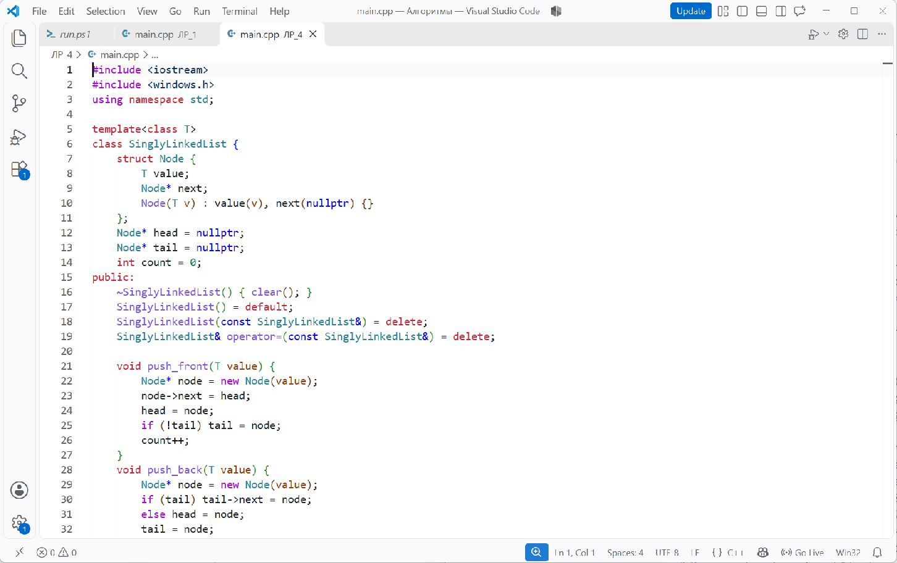
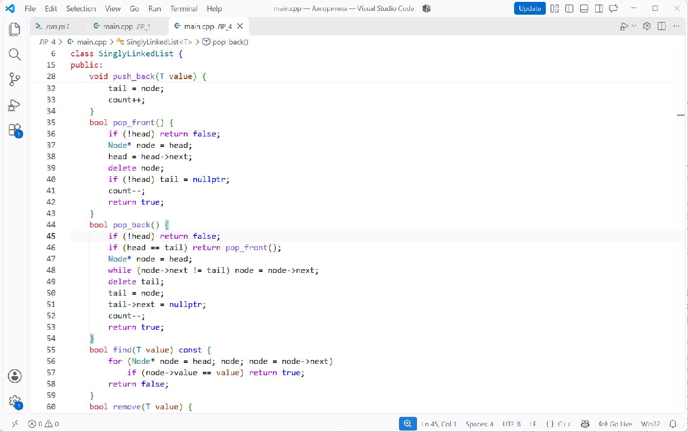
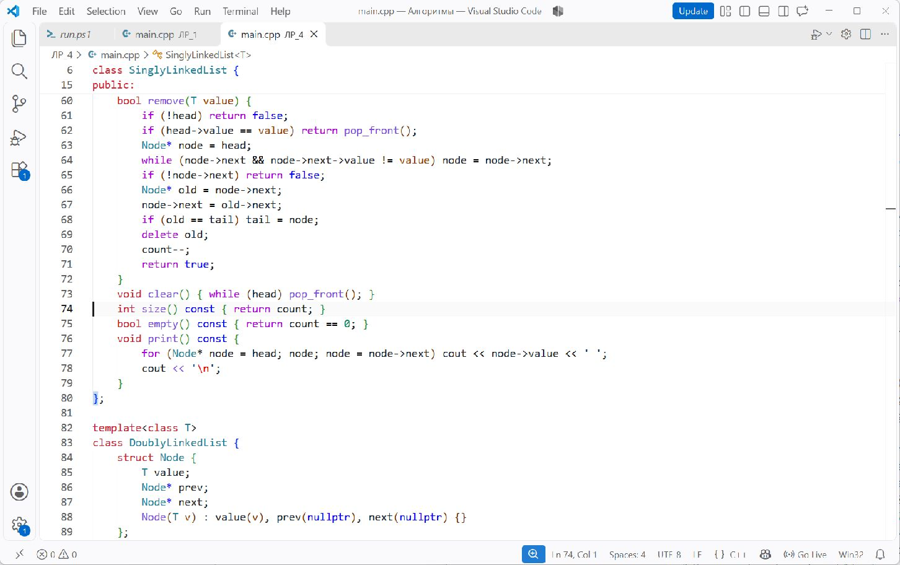
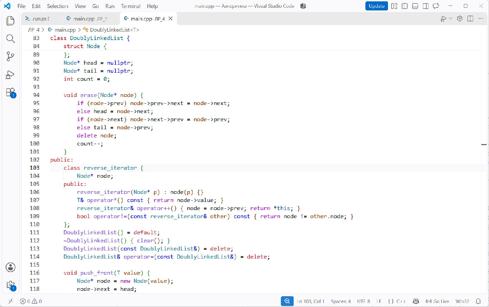
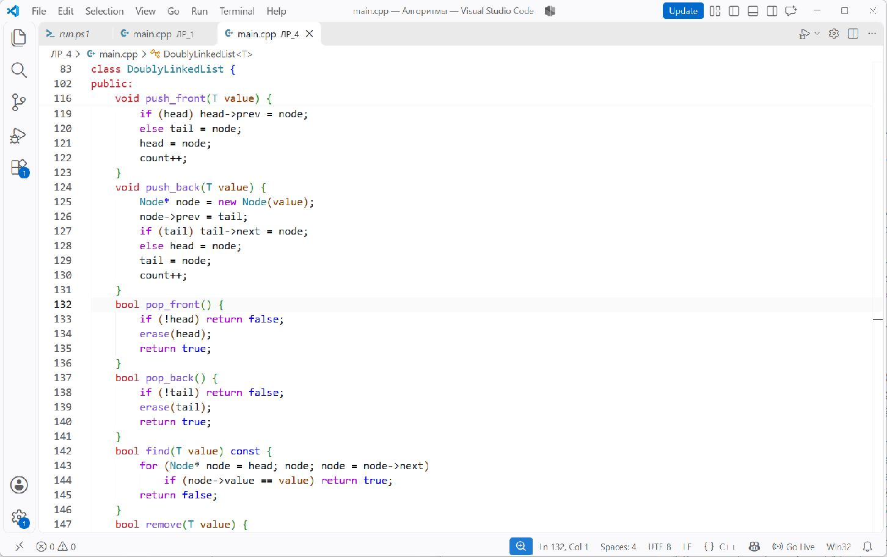
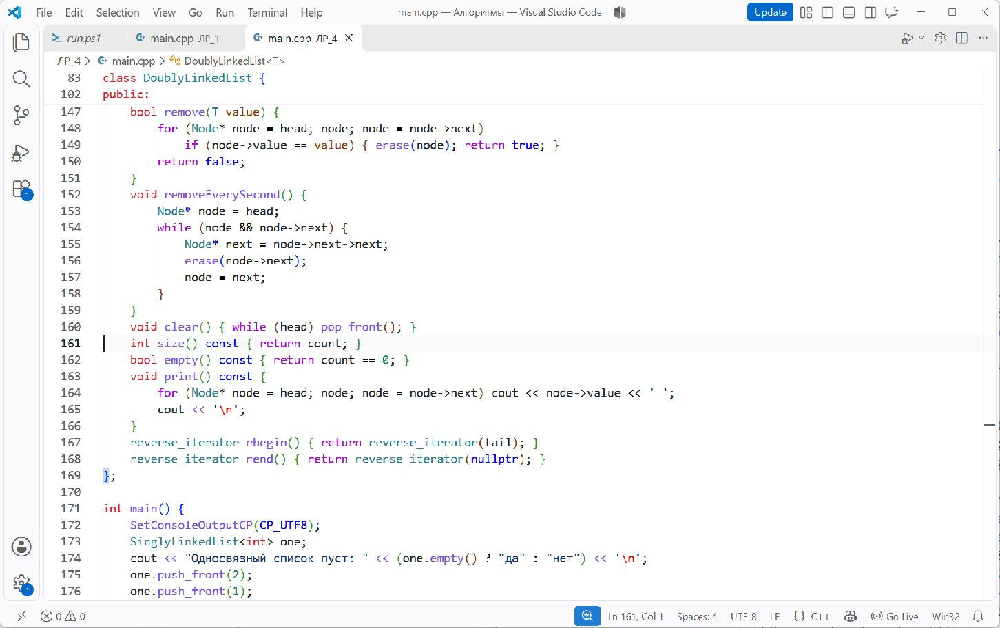
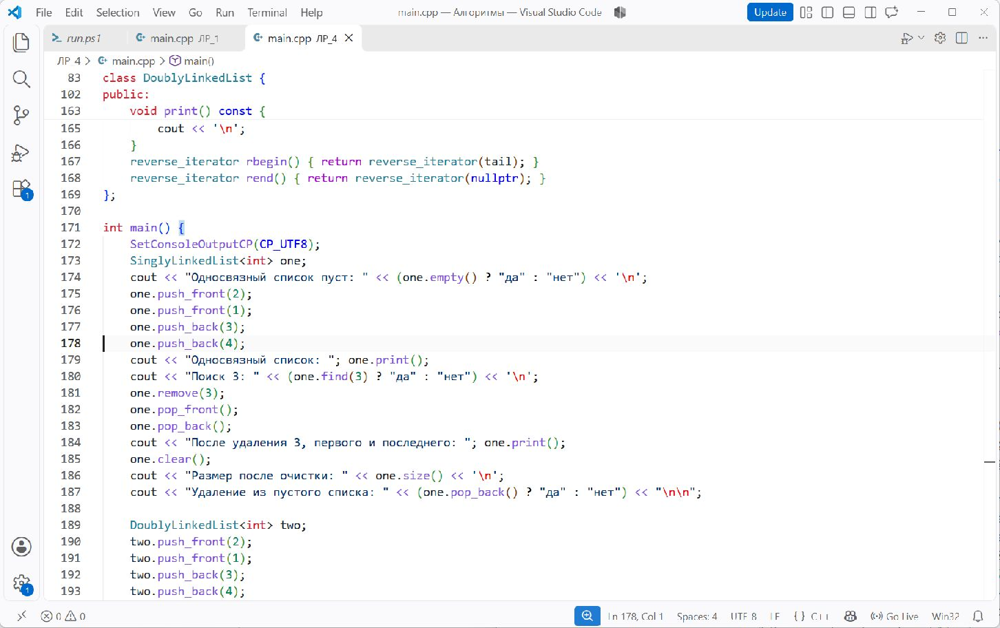
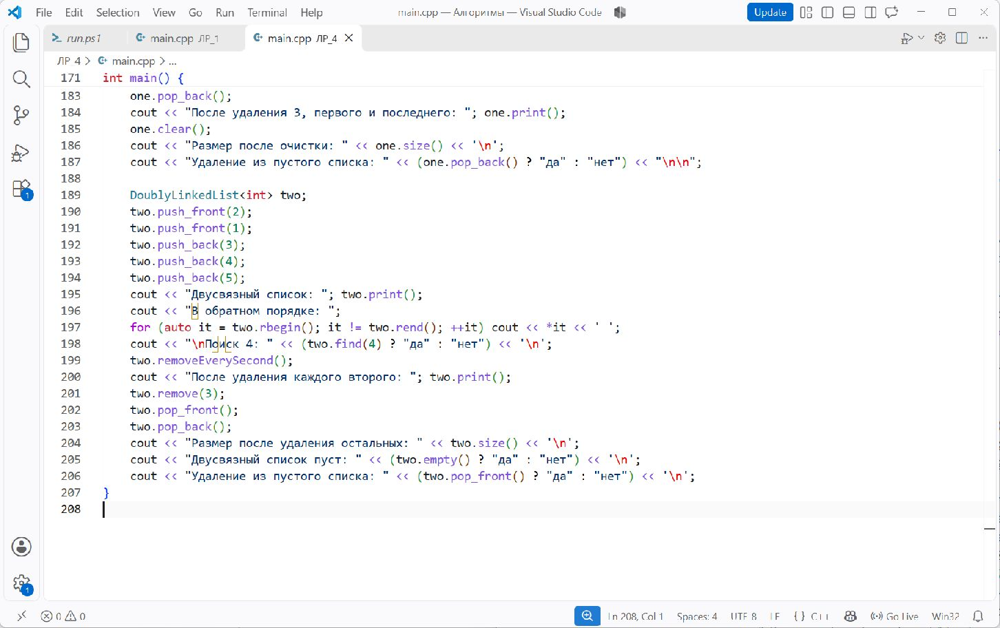
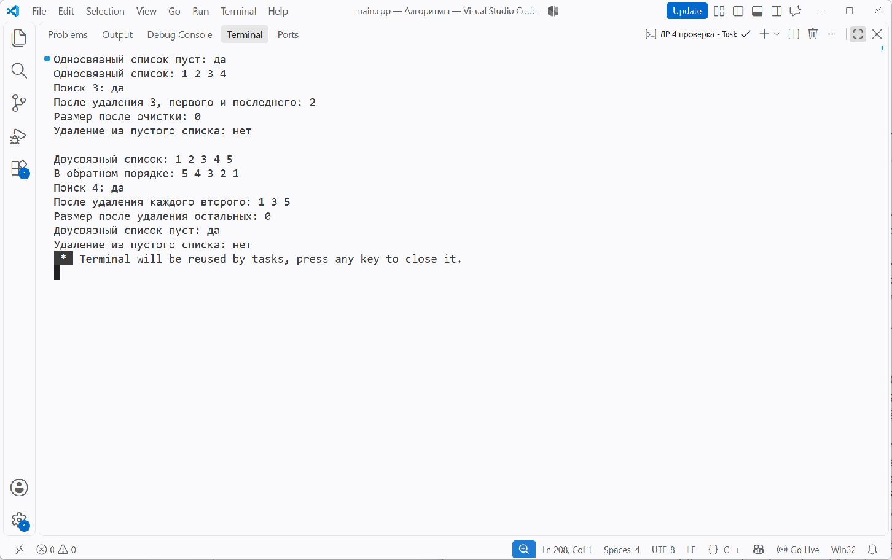

# Лабораторная работа № 4

**Тема:** Односвязный и двусвязный списки

**Цель:** Научиться создавать односвязный и двусвязный списки, выполнять основные операции с их элементами и использовать обратный итератор.

**Ссылка на репозиторий:** https://github.com/MAX-150-web/Algorithms

## Порядок выполнения работы

1. Ознакомился с теоретическим обоснованием работы.
2. Выполнил задачу продвинутого уровня.

**Вариант:** 10

**Задание:** Реализовать классы SinglyLinkedList и DoublyLinkedList с полной функциональностью. Для двусвязного списка реализовать reverse_iterator.

Рисунок 1 — Исходный код в Visual Studio Code, часть 1

Рисунок 2 — Исходный код в Visual Studio Code, часть 2

Рисунок 3 — Исходный код в Visual Studio Code, часть 3

Рисунок 4 — Исходный код в Visual Studio Code, часть 4

Рисунок 5 — Исходный код в Visual Studio Code, часть 5

Рисунок 6 — Исходный код в Visual Studio Code, часть 6

Рисунок 7 — Исходный код в Visual Studio Code, часть 7

Рисунок 8 — Исходный код в Visual Studio Code, часть 8

## Результат выполнения программы

Рисунок 9 — Выполнение программы в Visual Studio Code

Проверены операции списков, поиск, очистка, удаление каждого второго элемента и обратный обход. После очистки размер равен нулю, удаление из пустого списка обработано.

**Вывод:** Создал односвязный и двусвязный списки, реализовал их основные операции и обратный итератор для двусвязного списка. Проверил работу программы.

## Контрольные вопросы

**1. Чем связный список отличается от динамического массива?**

Элементы списка находятся в отдельных узлах и связаны указателями. Элементы динамического массива расположены подряд; к ним можно обратиться по индексу без последовательного обхода.

**2. Какие операции в односвязном списке выполняются за O(1)?**

Добавление и удаление первого элемента. При наличии указателя tail добавление в конец также выполняется за O(1).

**3. Почему удаление из конца односвязного списка требует O(n) времени?**

Чтобы обновить tail, нужно найти предпоследний узел, последовательно пройдя список от головы. Для списка из одного узла обход не нужен.

**4. Какие преимущества даёт хранение указателя tail в односвязном списке?**

Указатель позволяет сразу обратиться к последнему узлу и добавить элемент в конец за O(1), без обхода списка.

**5. Чем двусвязный список отличается от односвязного?**

В двусвязном списке узел хранит указатели на следующий и предыдущий узлы. В односвязном хранится только ссылка на следующий узел.

**6. Какие операции в двусвязном списке выполняются быстрее, чем в односвязном?**

Удаление последнего элемента и удаление известного узла выполняются за O(1), поскольку доступен предыдущий узел. Поиск узла по значению всё равно может потребовать O(n).

**7. Что такое «голова» (head) и «хвост» (tail) списка?**

Head указывает на первый узел, tail — на последний. В пустом списке оба указателя равны nullptr.

**8. Как удалить узел из середины односвязного списка?**

Найти предыдущий узел, направить его next на узел после удаляемого и освободить память удаляемого узла.

**9. Как удалить узел из середины двусвязного списка? Почему это проще?**

Связать предыдущий узел со следующим в обоих направлениях и удалить узел. Предыдущий узел доступен через prev, поэтому его не нужно искать от головы.

**10. Что произойдёт, если забыть обновить tail при удалении?**

Tail может указывать на удалённый узел. Последующее обращение к нему приведёт к неопределённому поведению и возможному сбою.

**11. Как реализовать реверс односвязного списка?**

Последовательно менять направление указателя next у каждого узла, сохраняя предыдущий и следующий узлы. В конце обновить head и tail.

**12. Как обнаружить цикл в связном списке?**

Использовать два указателя: медленный перемещается на один узел, быстрый — на два. Если они встретятся, список содержит цикл.

**13. В каких случаях стоит использовать список вместо массива?**

Когда часто вставляют или удаляют известные узлы и не требуется быстрый доступ по индексу. Список не требует перемещения остальных элементов.

**14. Какая дополнительная память требуется для каждого узла списка?**

Кроме значения, односвязный узел хранит один указатель, двусвязный — два. Также возможны накладные расходы выделения памяти и выравнивания.

**15. Почему доступ по индексу в списке имеет сложность O(n)?**

Узлы не расположены подряд. Чтобы найти элемент по индексу, приходится последовательно переходить по указателям, в худшем случае через весь список.
